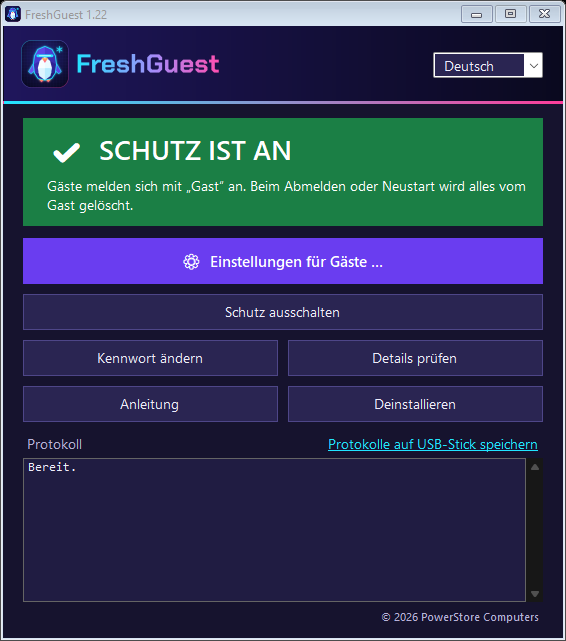
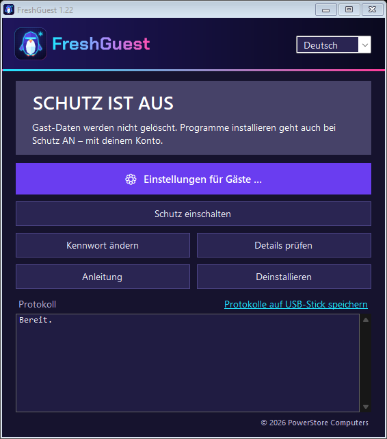
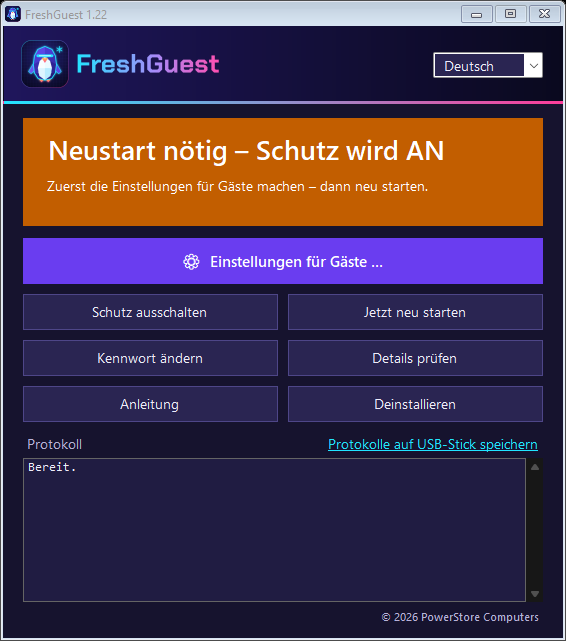
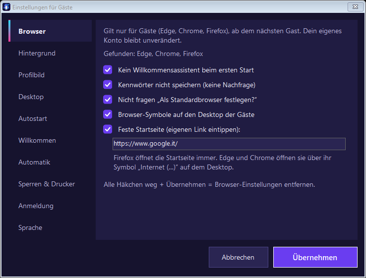

# FreshGuest – PC für Feriengäste

*(früher „Gäste-Schutz“)*

> **Die eigentliche Anleitung für den Alltag ist [FreshGuest-Anleitung.html](FreshGuest-Anleitung.html)**
> – Deutsch, Italiano und English in einer Datei, mit Bildern. Sie steckt auch im Programm
> (Knopf **„Anleitung“** bzw. Link **„Anleitung öffnen“** beim Einrichten).
> Diese Datei hier ist die technische Notiz dazu.

**Ziel:** Gäste klicken auf dem Anmeldebildschirm auf **„Gast“** (italienisch **„Ospite“**). Beim Abmelden oder Neustart
löscht Windows das Gastkonto komplett: Browserverlauf, Logins (Netflix, Gmail …), Downloads, Dokumente.
Der nächste Gast bekommt ein frisches, leeres Konto. Dein Admin-Konto bleibt erhalten.

Technisch nutzt FreshGuest den in Windows eingebauten **Shared PC Mode** (von Microsoft, kostenlos).
**Voraussetzung:** **Windows 11 Pro** (getestet; Enterprise/Education ungetestet, Home geht nicht). Das Admin-Konto braucht ein **Kennwort**.

---

## Kurzfassung

1. **`FreshGuest.exe`** vom USB-Stick starten (Admin-Abfrage: Ja) → Kennwort zweimal → **Installieren** → Einstellungen für Gäste → **Jetzt neu starten**.
2. **Testen:** als Gast Ordner anlegen → neu starten → Ordner ist weg.

Bei der Installation passiert: Programm nach `C:\Program Files\FreshGuest\`, Verknüpfung nur für dich,
Wiederherstellungspunkt (falls Windows einen erlaubt), alle vorhandenen Konten werden geschützt,
Shared PC Mode mit Gastkonto an, Windows-Schnellstart aus (Herunterfahren = echter Neustart),
Bereinigung übrig gebliebener Gast-Profile beim Systemstart.

## Bedienung

| Anzeige | Bedeutung |
|---|---|
|  | **Grün – Schutz ist an.** Gast-Daten werden beim Abmelden/Neustart gelöscht. |
|  | **Grau – Schutz ist aus.** Gast-Daten werden nicht gelöscht. |
|  | **Orange – Neustart nötig.** Die Änderung wirkt erst nach dem Neustart. |

- Ein-/Ausschalten, Kennwort ändern, Einstellungen und Deinstallieren fragen nach dem FreshGuest-Kennwort (5 Fehlversuche → Programm schließt).
- **Programme installieren geht auch bei Schutz AN** – mit deinem Konto. Der Schutz betrifft nur Gast-Konten.
- Sprache oben rechts: Deutsch / Italiano / English (Standard = Windows-Sprache).

## Einstellungen für Gäste (⚙)

Was man *als Gast* einstellt, ist beim nächsten Gast weg (jeder Gast = neues Konto). Deshalb:
**⚙ Einstellungen für Gäste …** → Bereich links wählen → **Übernehmen**. Kein Neustart nötig.

| Bereich | Was passiert technisch |
|---|---|
| **Browser** | Richtlinien für Edge, Chrome, Firefox im **Windows-Standardprofil** (`C:\Users\Default\NTUSER.DAT` → `HKCU\Software\Policies` jedes neuen Gastes): kein Willkommensassistent (Chrome: Chrome-Anmeldung aus), Kennwörter nicht speichern, keine Standardbrowser-Frage, Startseite (Firefox per Richtlinie; Edge/Chrome ignorieren Startseiten-Richtlinien auf PCs ohne Domäne → Symbol „Internet (Edge/Chrome)“ auf dem Desktop des Standardprofils). Gilt nur für Gäste; bis 1.7 standen die Werte in `HKLM` und die Symbole auf dem öffentlichen Desktop – das räumt das Update automatisch auf. |
| **Hintergrund** | Bild wird nach `C:\ProgramData\GaestePC\Hintergrund.*` kopiert; die Hintergrund-Richtlinie wird ins **Windows-Standardprofil** (`C:\Users\Default\NTUSER.DAT`) geschrieben → gilt für jeden **neuen** Gast, nicht für dein Konto. |
| **Autostart** | Verknüpfung im Autostart-Ordner aller Benutzer → `FreshGuest.exe --gast-start`. Startet die eingestellte Seite/das Programm nur, wenn das Konto **nicht** geschützt ist (= Gast). Ziel steht lesbar in `HKLM\SOFTWARE\FreshGuest`. |
| **Profilbild** | Nur für Gäste: Geplante Aufgabe `FreshGuest-Profilbild` (SYSTEM, bei jeder Anmeldung) gibt jedem Konto, das *nicht* in der Shared-PC-Schutzliste steht, das Bild – so, wie Windows es selbst speichert (`HKLM\SOFTWARE\Microsoft\Windows\CurrentVersion\AccountPicture\Users\<SID>`, Dateien in `C:\Users\Public\AccountPictures\<SID>`). Bilder liegen in `C:\ProgramData\GaestePC\Profilbild\`. Dein Konto und die Kachel „Gast“ auf dem Anmeldebildschirm bleiben beim Windows-Standardbild. Die alte Methode (Windows-Standardbilder überschreiben, traf auch den Admin) wird beim Programmstart automatisch rückgängig gemacht. |
| **Desktop** | Dateien werden nach `C:\Users\Default\Desktop` kopiert (Programme als `.lnk`, Internetseiten als `.url`) → jeder **neue** Gast hat sie auf dem Desktop. |
| **Willkommen** | Texte stehen lesbar in `HKLM\SOFTWARE\FreshGuest` (`GastWillkommen`, `W_*`). `--gast-start` zeigt beim Gast das Fenster in der Windows-Sprache des Gastes. |
| **Abmelden & Neustart** | Abmelden: `--gast-start` bleibt in der Gast-Sitzung aktiv, misst die Zeit ohne Eingabe (`GetLastInputInfo`), überspringt laufende Videos (`ES_DISPLAY_REQUIRED`), zeigt 60 s „Noch da?“ und meldet dann ab (`ExitWindowsEx`). Neustart: geplante Aufgabe `FreshGuest-Neustart` (SYSTEM, täglich, `shutdown /r /t 300`). |
| **Sperren & Drucker** | Im Windows-Standardprofil: `Policies\Explorer\NoControlPanel`, `Policies\System\DisableRegistryTools` + `DisableCMD=2`; Standarddrucker über `Windows NT\CurrentVersion\Windows\Device` + `LegacyDefaultPrinterMode=1`. |

Deinstallieren entfernt alles wieder.



## Protokolle, Kennwort, Update

- **Protokolle:** bei der Einrichtung automatisch auf den USB-Stick (wenn die exe von dort gestartet wurde), sonst in
  `C:\Program Files\FreshGuest\`; später über
  „Protokolle auf USB-Stick speichern“. Ordner `FreshGuest-Protokolle\<PC>_<Datum>\` mit `Info.txt`, `Status.txt`,
  `Protokoll-Fenster.txt`, `GaestePC.log`, `Bereinigung.log`, `SharedPCSetup.log`, `SharedPC-Registry.reg`,
  `Richtlinien-Registry.reg`. Keine Kennwörter, keine persönlichen Daten.
- **Kennwort vergessen** (Eingabeaufforderung als Administrator):
  ```
  "C:\Program Files\FreshGuest\FreshGuest.exe" --kennwort-zuruecksetzen
  ```
- **Update:** neue `FreshGuest.exe` vom Stick starten → ersetzt die installierte Version (auch das alte „Gäste-Schutz“).
  Kennwort, Einstellungen und Schutz bleiben, kein Neustart nötig.

## Was FreshGuest *nicht* macht

Es setzt **nur die Gast-Daten** zurück, nicht die ganze Festplatte wie „Freeze“-Programme.
Für einen Gäste-PC reicht das, weil Gäste ohne Admin-Rechte Windows selbst nicht verändern können.

## Getestet

Am 09.11.2026 auf dem echten Gäste-PC (Windows 11 Pro, italienisch) mit **Version 1.0** geprüft:
- Gast-Kachel erscheint, Anmeldung ohne Kennwort funktioniert.
- Als Gast einen Ordner angelegt, neu gestartet → Ordner war weg. ✅
- Admin-Anmeldung funktioniert. Windows zeigt dafür nur noch **Benutzername + Kennwort** (keine Namensliste) –
  im Shared PC Mode normal und sicherer. **Admin-Namen aufschreiben!**

**Auf dem Gäste-PC bestätigt (1.3):** Hintergrund für Gäste.
**Lizenz (ab der Veröffentlichung):** GNU GPL v3.0 oder neuer (statt MIT + Commons Clause). Veränderte Fassungen dürfen nicht „FreshGuest“ heißen und nicht das Logo tragen.

**Neu in 1.22:** **Gäste wählen die Windows-Sprache selbst** (`src\Sprachwahl.cs`): Spalte mit gezeichneten Flaggen rechts im Willkommens-/Hinweisfenster (bzw. eigenes kleines Fenster). Klick → Rückfrage in der Zielsprache → Wunsch in `HKCU\Software\FreshGuest\Sprachwunsch` → die Wache (SYSTEM) stellt das Standardprofil um und bestätigt (`SprachwunschOk`) → Abmelden → der Helfer wählt „Guest“ und klickt selbst „Anmelden“ (`SprachwechselAnmelden`) → 20 s nach der Anmeldung (oder nach 5 Minuten ohne Anmeldung) wieder die Standardsprache. **Am Gäste-PC noch zu testen.**

**Neu in 1.21:** Einstellung **Sprache → Windows-Sprache für Gäste** (`src\Sprache.cs`). Gäste bekamen die Installationssprache von Windows statt der Sprache des Admin-Kontos (gefunden an einem PC mit drei Sprachpaketen: Admin Englisch, Gast Deutsch). Schreibt ins Standardprofil `PreferredUILanguages`, `User Profile\Languages` (+ Eingabemethode `<LANGID>:<Tastatur des Admins>`) und `Keyboard Layout\Preload\1`; alte Werte werden gesichert (`GastSpr_*`) und beim Ausschalten/Deinstallieren zurückgeschrieben. Einstellungsfenster etwas höher (Platz für den 10. Reiter). **Am PC mit mehreren Sprachpaketen noch zu testen.**

**Neu in 1.20:** **Kachelbild fest eingebaut** (am Gäste-PC getestet: erscheint erst mit der Kachel, nicht über der Uhr) – aktiv, sobald ein Profilbild für Gäste eingestellt ist. **Installation:** Häkchen „Danach sofort neu starten“ entfernt (erst Einstellungen, dann Neustart). **Hauptfenster:** „Einstellungen für Gäste“ ist jetzt der große farbige Knopf oben. **Willkommen:** Check-out, Kontakt, eigener Text und ein frei benennbares **Zusatzfeld** je Sprache einzeln (`W_Checkout`, `W_Checkout_it`, `W_Checkout_en`, `W_Checkout_4` usw.; leer = deutscher Eintrag), jede Sprache in einem eigenen Kasten, auf breiten Bildschirmen zweispaltig. Wählbare **4. Sprache** für alle Gast-Fenster (`GastSprache4`: fr, es, nl, pl, cs) mit übersetzten festen Texten. **Am Gäste-PC noch zu testen.**

**Neu in 1.19:** Die Aufgaben `FreshGuest-Profilbild` und `FreshGuest-Neustart` starten jetzt auch im **Akkubetrieb** (schtasks legte sie mit „nur im Netzbetrieb“ an; beim Update werden vorhandene Aufgaben korrigiert). **Lizenz:** MIT + Commons Clause (kostenlos nutzbar, kein Verkauf), © 2026 PowerStore Computers (LICENSE, README, Fußzeile im Hauptfenster und in der Anleitung, Datei-Eigenschaften). **Test Kachelbild:** Das Bild der Kachel „Guest“ steckt fest in `Windows.SharedPC.CredentialProvider.dll`. Versuchsweise legt der Helfer das Gast-Profilbild als rundes, klick-durchlässiges Fenster über die Kachel (`src\Kachelbild.cs`) – nur aktiv mit `HKLM\SOFTWARE\FreshGuest\KachelBildTest=1` (`werkzeuge\TEST_Kachelbild-einschalten.cmd`). Offen: ob Windows das Fenster über dem Anmeldebildschirm zeigt und ob es über dem Sperrbildschirm schwebt.

**Neu in 1.18:** Alle Fenster für Gäste sind **dreisprachig** (Deutsch, Italienisch, Englisch gleichzeitig, fester Text – keine Sprachwahl mehr): Willkommensfenster, „Noch da?“ und das neue **Hinweis-Fenster** (Einstellung *Automatik → Hinweis für Gäste beim Anmelden zeigen*; `GastHinweis` in `HKLM\SOFTWARE\FreshGuest`): Der PC wird nach jedem Gast zurückgesetzt; nennt auch automatisches Ausschalten und täglichen Neustart (`GastNeustartZeit`). Reagiert auf „Noch da?“ 60 Sekunden niemand, **fährt der PC jetzt herunter** (`shutdown /s`, vorher: abmelden; darf der Gast nicht herunterfahren, wird abgemeldet). Der Reiter „Abmelden & Neustart“ heißt jetzt „Automatik“. **Am Gäste-PC noch zu testen.**

**Neu in 1.17:** Anmeldebildschirm gelöst (am Gäste-PC getestet). **„Guest“ wird automatisch ausgewählt** (Standard): Windows wählt unter Shared PC immer „Anderer Benutzer“ vor, per Richtlinie lässt sich das nicht ändern (`DefaultCredentialProvider` und `LastLoggedOnProvider` wirken nicht). Darum läuft jetzt eine Wache (Aufgabe `FreshGuest-Anmeldung`, SYSTEM, `FreshGuest.exe --anmeldewache`), die bei jedem neuen Anmeldebildschirm einen Helfer direkt auf dem Anmelde-Desktop startet (`--anmeldehelfer`); der wählt über die Bedienungshilfen-Schnittstelle die Kachel „Guest“ aus. Neue Einstellung **Anmeldung → Nur „Guest“ anzeigen**: schließt per `ExcludedCredentialProviders` (unter `HKLM\SOFTWARE\Microsoft\Windows\CurrentVersion\Policies\System`) alle Anmelde-Wege außer dem von Shared PC aus. Admin-Zugang: am Anmeldebildschirm **Strg + Alt + F** → „Anderer Benutzer“ für 10 Minuten. Solange du angemeldet bist, ist die Sperre aufgehoben. Schutz vor dem Aussperren: Bis die Tastenkombination an dem PC einmal erfolgreich benutzt wurde, schaltet sich die Option nach 3 Minuten am Anmeldebildschirm selbst aus; außerdem entfernt die Bereinigung beim Start die Sperre, wenn exe, Aufgabe oder Shared PC fehlen. Protokoll: `C:\ProgramData\GaestePC\Anmeldung.log`. **Am Gäste-PC bestätigt (10.11.2026):** automatische Auswahl, „Nur Guest“, Tastenkombination direkt am Anmeldebildschirm (ohne Gast-Anmeldung, ohne Meldung – der Bildschirm flackert kurz). Offen: Das Bild der Kachel „Guest“ (Figur mit Fragezeichen) ist fest in `Windows.SharedPC.CredentialProvider.dll` eingebaut und lässt sich nicht einstellen.

**Neu in 1.16:** Ursache der Meldung „Anderer Benutzer – Benutzername und Kennwort eingeben“ nach jedem Start gefunden: Das Admin-Konto hatte **kein Kennwort** (am Gäste-PC bestätigt – mit Kennwort ist sie weg). Die Einrichtung prüft das jetzt und installiert erst mit Kennwort. Vorauswahl „Gast“ wieder aktiv (Anbieter `Windows.SharedPC.CredentialProvider` als zuletzt benutzt, beim Start und 10 s nach jeder Anmeldung) – mit Kennwort neu zu testen.
**Neu in 1.15:** Die Gast-Kachel hängt an `HKLM\…\SharedPC\AccountManagement\AccountModel` (2 = Gast). Windows schreibt den Wert nur bei einer Änderung laut `SharedPC\NodeValues`. FreshGuest ergänzt ihn bei jedem Start, falls er fehlt, und entfernt ihn beim Ausschalten (behebt: Gast-Kachel blieb nach dem Deinstallieren; Gast-Kachel fehlte nach dem Zurücksetzen-Skript 1.14).
**Komplett zurücksetzen:** `werkzeuge/FreshGuest-Zuruecksetzen.cmd` (als Administrator) entfernt alles, was FreshGuest oder das alte „Gäste-Schutz“ je eingerichtet hat: Shared PC Mode aus, Shared-PC-Gastkonten und verwaiste Profile, Aufgaben, Programm-/Datenordner, Browser-Richtlinien (nur eigene Werte), Einstellungen im Standardprofil, Profilbilder, Anmeldebildschirm. Eigene Konten/Daten bleiben. Protokoll neben dem Skript.
**Neu in 1.14, noch nicht getestet:** Ursache der Meldung „Anderer Benutzer – Benutzername und Kennwort eingeben“ nach dem Start gefunden (Bereinigung.log 1.13: AutoAdminLogon war 0; beim Start stand „zuletzt angemeldet“ = Anmelde-Anbieter „Guest“ ohne Konto). Die Gast-Vorauswahl ist entfernt; FreshGuest trägt beim Start und 10 s nach jeder Anmeldung dein Konto mit Kennwort-Anmeldung als „zuletzt angemeldet“ ein. Nach dem Start: deine Kachel mit Kennwortfeld, unten links „Guest“.
**Neu in 1.13, noch nicht getestet:** Ursache für „Anderer Benutzer – Benutzername und Kennwort eingeben“ nach jedem Neustart vermutlich eine eingeschaltete automatische Windows-Anmeldung (`Winlogon\AutoAdminLogon`) ohne gültige Daten. FreshGuest schaltet sie beim Einrichten und bei jedem Start aus (entfernt auch ein gespeichertes Klartext-Kennwort) und protokolliert die Werte ohne Kennwort in `Bereinigung.log` und `Info.txt`.
**Neu in 1.12:** Option „Nur Gast“ endgültig entfernt (getestet: sie setzt „Letzten Benutzer nicht anzeigen“ = 1, dadurch zeigt Windows zuerst das Formular „Anderer Benutzer“ – schlechter als der Standard, der „Gast“ vorauswählt und nur „Gast“ + „Anderer Benutzer“ zeigt). Das Update schaltet sie automatisch zurück.
**Neu in 1.11:** Getestet am Gäste-PC (1.10): Gast ist nach dem Start vorausgewählt, der Gast hat den Pinguin als Profilbild. Automatisches Anmelden des Gastes ohne Klick geht mit Shared PC nicht (Konto entsteht erst beim Klick) – bewusst kein Umbau. Die Sperren sind getrennt: „Programme installieren sperren“ (.msi, AppData, Temp) und „Programme aus Downloads und vom Desktop sperren“ (noch nicht getestet).
**Neu in 1.10, noch nicht getestet:** Sperren & Drucker: „Installationspakete (.msi) sperren“ und „Programme aus Downloads, Desktop und AppData sperren“ (Software-Einschränkungsrichtlinie im Standardprofil, `HKCU\Software\Policies\Microsoft\Windows\Safer` jedes neuen Gastes; dein Konto bleibt frei; beide standardmäßig aus). Admin-Installationen sind für Gäste durch Shared PC ohnehin gesperrt.
**Neu in 1.9, noch nicht getestet:** Vorauswahl „Gast“ wird beim Start sofort und 10 Sekunden nach jeder Anmeldung gesetzt (vorher 1 Minute – zu spät, wenn der Gast gleich herunterfährt). Profilbild: Die SYSTEM-Aufgabe setzt es einige Sekunden nach der Gast-Anmeldung; die Gast-Sitzung (`--gast-start`) startet danach das Startmenü neu, damit es das Bild anzeigt.
**Neu in 1.8, noch nicht getestet:** Browser-Einstellungen (inkl. Startseite) und Browser-Symbole gelten nur noch für Gäste (Standardprofil statt HKLM / öffentlichem Desktop); beim Update wird automatisch umgezogen.
**Neu in 1.7, noch nicht getestet:** Version steht im Fenstertitel. Kachel „Gast“ wird nach Neustart/Abmelden vorausgewählt (Anmelde-Anbieter `Windows.SharedPC.CredentialProvider` als „zuletzt benutzt“ eingetragen; die Bereinigung läuft dafür zusätzlich 1 Minute nach jeder Anmeldung). Das Profilbild-Skript protokolliert jeden Lauf in `GaestePC.log` (`[Profilbild]`), „Details prüfen“ zeigt Aufgaben, Konten und Anmeldebildschirm-Werte.
**Ursachen gefunden (Diagnose am Gäste-PC):** Shared PC schreibt `dontdisplaylastusername = 1` in die lokale Gruppenrichtlinie (`C:\Windows\System32\GroupPolicy\Machine\Registry.pol`); Windows wendet sie bei jedem Start/Richtlinien-Abgleich neu an (HP Sure Click löst das oft aus). FreshGuest ändert jetzt genau diesen einen Wert in der Datei (Sicherung `Registry.pol.vor-freshguest`). Außerdem wurden beim erneuten Einrichten Gast-Konten von Shared PC (`shpc…`, Liste unter `HKLM\…\SharedPC\CreatedLocalAccounts`) fälschlich geschützt – das passiert nicht mehr, und bestehende falsche Einträge entfernt die Bereinigung beim Start.
**Neu in 1.6, noch nicht getestet:** Update erkennt jetzt jeden neuen Build (nicht nur eine neue Versionsnummer) und schreibt danach die Skripte auf dem PC neu (Bereinigung/Anmeldebildschirm, Profilbild) – vorher lief nach einem Update oft weiter die alte installierte Version.
**Korrekturen, noch nicht getestet:** Der Anmeldebildschirm zeigt nach dem Neustart wieder die Kacheln „Gast“ + Admin statt des leeren Formulars „Anderer Benutzer“ (Shared PC schaltet „Letzten angemeldeten Benutzer nicht anzeigen“ ein; FreshGuest schaltet es beim Einrichten und bei jedem Start wieder aus, Protokoll in `Bereinigung.log`). Das Profilbild gilt nur noch für Gäste. Installations-Protokolle landen im Installationsordner statt auf dem Desktop (vom USB-Stick: weiter auf dem Stick). Neu unter Einstellungen → **Anmeldung**: „Nur die Kachel „Gast“ anzeigen“ (dein Konto ausgeblendet, Anmeldung über „Anderer Benutzer“; ausgeblendet wird nur, wenn die Richtlinie dafür sicher an ist). Die Prüfung auf Toolwiz Time Freeze vor der Installation ist entfernt.
**Neu in 1.5, noch nicht getestet:** Navigation links in den Einstellungen; Profilbild für Gäste, Desktop für Gäste, Willkommensfenster, automatisch abmelden, täglicher Neustart, Sperren, Standarddrucker für Gäste. Fehler behoben: ausgeschaltete Einstellungen blieben in der Registry stehen.
**Neu in 1.4, noch nicht getestet:** dunkles Design, kein automatischer Neustart nach der Installation (erst Einstellungen, dann „Jetzt neu starten“), Browser-Symbole für Edge/Chrome/Firefox auf dem Desktop der Gäste, Anmeldebildschirm-Registry in den Protokollen.
**Noch nicht getestet (1.3):** drei Sprachen, Name FreshGuest + Pinguin-Logo,
Einstellungen für Gäste (Browser, Hintergrund, Autostart), Anleitung im Programm, Update vom alten Gäste-Schutz.
Version 1.0 liegt zur Sicherheit in `backup-v1.0\`.

---

## Dateien in diesem Ordner

| Datei | Zweck |
|---|---|
| `FreshGuest.exe` | **Das Programm** – nur diese Datei auf den Gäste-PC kopieren |
| `FreshGuest-Anleitung.html` | Anleitung DE/IT/EN (steckt auch in der exe) |
| `GaestePC.ps1` | Das Skript für die Systemarbeit (ist in der exe eingebaut) |
| `1-…`, `2-…`, `3-….cmd` | Alternative ohne Fenster (Skript direkt starten) |
| `src\` | Quellcode; `src\build.cmd` baut die exe |
| `anleitung\` | Vorlage der Anleitung; `anleitung\bauen.ps1` erzeugt `FreshGuest-Anleitung.html` |
| `bilder\` | Fensterbilder (ohne Endung = Deutsch, `-it`, `-en`) – erzeugt mit `FreshGuest.exe --snapshot <ordner>` |
| `logo\` | Logo (Neon-Pinguin) als `.svg`, `FreshGuest.ico`, PNGs 16–1024 px, Schriftzüge. Neu erzeugen: `logo\render.ps1` |

**Neu bauen (Reihenfolge):** `src\build.cmd` → `FreshGuest.exe --snapshot <tmp>` → Bilder nach `bilder\` →
`anleitung\bauen.ps1` → `src\build.cmd` (bettet die Anleitung ein).

**Ausprobieren ohne etwas zu verändern:** `FreshGuest.exe --demo` (z. B. auf deinem eigenen PC).
