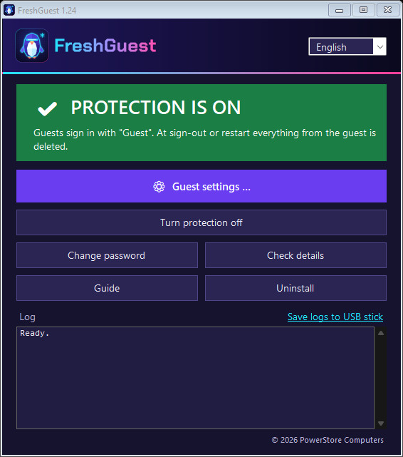
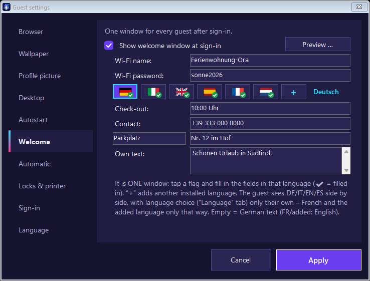
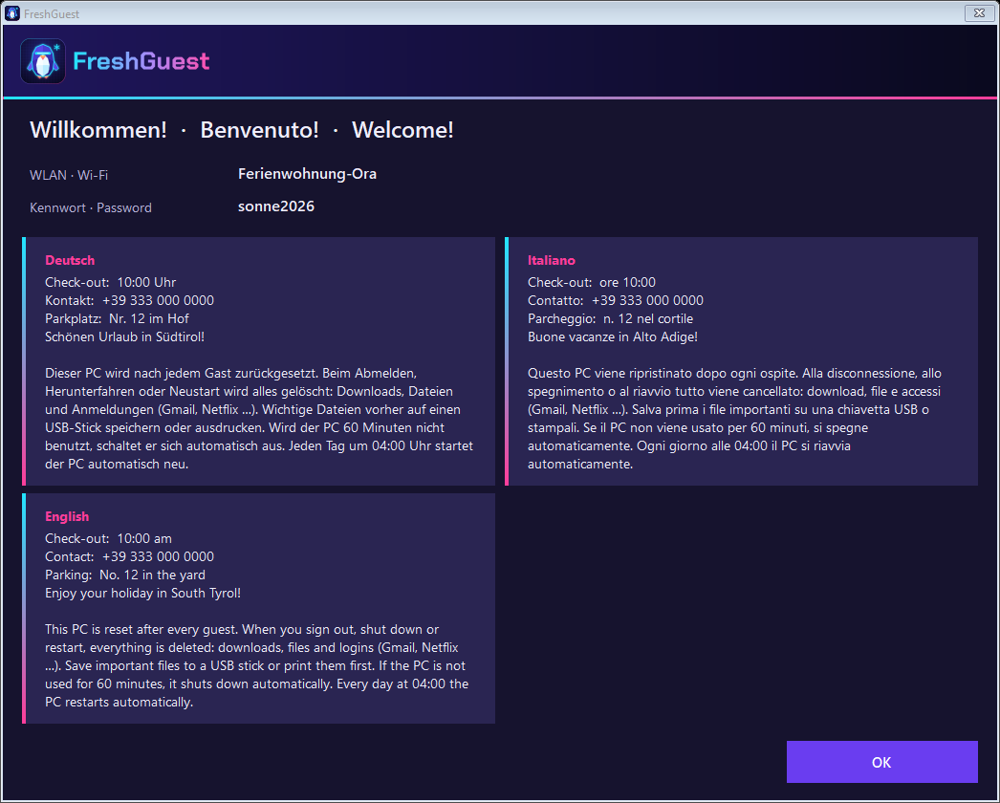
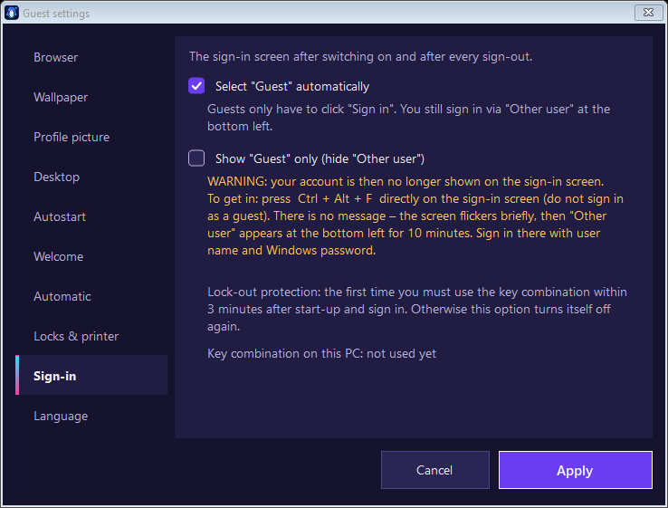
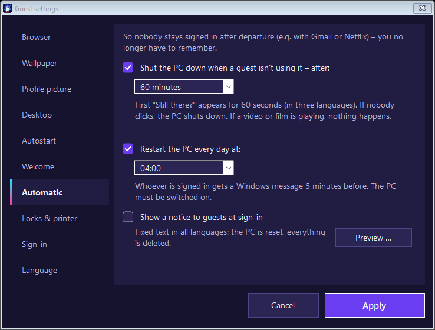
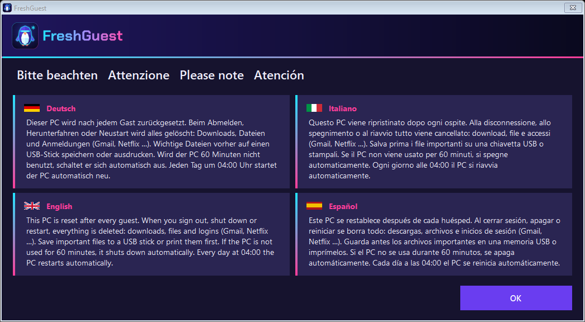
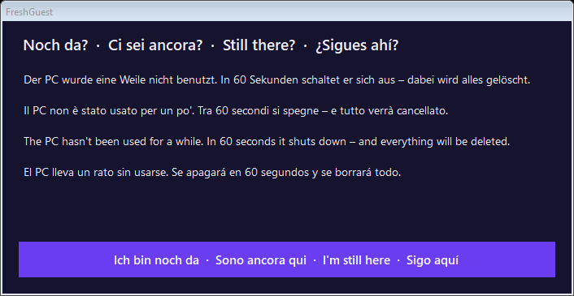

<p align="center">
  <picture>
    <source media="(prefers-color-scheme: dark)" srcset="logo/FreshGuest-Schriftzug.png">
    
  </picture>
</p>

<p align="center"><b>A fresh, empty Windows account for every guest – for holiday flats, hotels, internet cafés and every PC that strangers use one after another.</b></p>

<p align="center"><b>⚠️ Requires Windows 11 Pro.</b> Windows Home does not work.</p>

> 🇬🇧 **English:** FreshGuest sets up a Windows PC for guests. On the sign-in screen guests just click “Sign in”; when they sign out or the PC restarts, Windows deletes everything they left behind. **Windows 11 Pro only** – it does not work with Windows Home. Fits holiday flats, hotels, internet cafés, libraries, waiting rooms and anywhere strangers use the same PC one after another. The full guide (DE/IT/EN) is built into the program and comes with every [release](../../releases).
>
> 🇩🇪 **Deutsch:** FreshGuest richtet einen Windows-PC für Feriengäste ein. Gäste klicken auf dem Anmeldebildschirm nur auf „Anmelden“; beim Abmelden oder Neustart löscht Windows alles, was der Gast hinterlassen hat. **Nur für Windows 11 Pro** – mit Windows Home funktioniert es nicht. Passt für Ferienwohnungen, Hotels, Internetcafés, Bibliotheken, Wartezimmer und überall, wo Fremde nacheinander am selben PC sitzen. Die ausführliche Anleitung (DE/IT/EN) steckt im Programm und liegt jedem [Release](../../releases) bei.
>
> 🇮🇹 **Italiano:** FreshGuest prepara un PC Windows per gli ospiti. Gli ospiti cliccano solo su «Accedi» nella schermata di accesso; alla disconnessione o al riavvio Windows cancella tutto ciò che hanno lasciato. **Solo per Windows 11 Pro** – con Windows Home non funziona. Adatto a case vacanze, hotel, internet café, biblioteche, sale d'attesa e ovunque persone diverse usino lo stesso PC una dopo l'altra. La guida completa (DE/IT/EN) è inclusa nel programma e in ogni [release](../../releases).

---

## What it does

When the PC starts, the **“Guest”** tile is already selected – guests just click **Sign in**, no password needed.
When they sign out or the PC restarts, Windows deletes the guest account completely: browser history, logins
(Netflix, Gmail …), downloads and documents. The next guest gets a fresh, empty account.
Your own admin account and your data stay untouched.

FreshGuest doesn't freeze the whole disk. It uses Windows' built-in, free **Shared PC mode** with a guest account
and gives it a simple, password-protected interface:

| | |
|---|---|
|  |  |

Every window the guest sees is shown in **German, Italian, English and Spanish at the same time** – you never know
who is sitting at the PC:



## Where it fits

Wherever strangers use the same PC one after another:

- **Holiday flats, B&Bs, hotels, hostels** – a guest PC or the PC in the lobby
- **Internet cafés and copy shops**
- **Libraries and public PCs** in town halls or community centres
- **Waiting rooms and reception areas** – garages, doctors' surgeries, car dealers
- **Co-working spaces, trade-fair stands, clubhouses and youth centres**

Good to know for internet cafés: FreshGuest is set up **on each PC separately** – there is no central management
for many PCs – and it does **no billing or time limits** per minute, only the automatic shutdown after idle time.
Commercial use is explicitly allowed (see [License](#license)).

## Guest settings

All settings apply to guests only – your own account stays as it is.

- **Browser** – Edge and Chrome without first-run wizards, password saving or “make default” prompts; desktop icons and a fixed start page. Both follow the guest's Windows language (Firefox stays in its install language, so it gets no icon); the browsers' own icons on the shared desktop are moved away so guests see each browser only once
- **Wallpaper** and **profile picture** for guests – the picture also replaces the grey question-mark figure on the “Guest” tile of the sign-in screen
- **Desktop** – files, programs and links every new guest finds on the desktop
- **Autostart** – open a page or program when a guest signs in
- **Welcome window** – Wi-Fi name and password; check-out, contact, an extra field of your choice and your own text, each per language
- **Automatic** – shut the PC down when a guest leaves it unused (after a 60-second “Still there?”), restart daily at a fixed time, show a notice that the PC is reset after every guest
- **Locks & printer** – lock Control Panel / Settings, command prompt, registry editor, installing programs and running programs from Downloads; default printer for guests
- **Language** – the Windows display language for guests, chosen from the language packs installed on the PC (otherwise guests get the language Windows was installed with); optionally guests first see only flag buttons (German, Italian, English, Spanish – plus French if its language pack is installed) – after picking one, the PC signs out briefly and back in, and the welcome window appears in that language only
- **Sign-in** – “Guest” is selected automatically; optionally show **only** “Guest” and reach your own account with **Ctrl + Alt + F** on the sign-in screen

| | |
|---|---|
|  |  |
|  |  |

Switching protection on/off, changing settings and uninstalling all ask for the FreshGuest password.
Uninstall removes everything again.

The interface and the guide are available in **German, Italian and English** (default: Windows language).

## Requirements

- **Windows 11 Pro.** This is the edition FreshGuest is built and tested on.
  Windows 11 **Home does not work** – it has no Shared PC mode. (Enterprise and Education have Shared PC mode too, but are untested.)
- An administrator account **with a password** (a PIN alone is not enough)
- .NET Framework 4.8 (included in Windows 11)
- No other “reset on restart” program (e.g. disk-freeze tools) – uninstall it first

## Usage

1. Download `FreshGuest.exe` from the [latest release](../../releases/latest) and copy it to a USB stick.
2. On the guest PC, sign in with your admin account, start `FreshGuest.exe` (confirm the admin prompt) → set a FreshGuest password → **Install**.
3. Click the big **⚙ Guest settings** button and set everything up. Only then click **Restart now**. Protection is active after the restart.
4. Test it: sign in as guest, create a folder, restart – the folder is gone.

Try it without changing anything: `FreshGuest.exe --demo`.

Forgot the FreshGuest password? In an administrator command prompt:

```bat
"C:\Program Files\FreshGuest\FreshGuest.exe" --kennwort-zuruecksetzen
```

To update, simply start a newer `FreshGuest.exe` – password, settings and protection are kept.

`werkzeuge\FreshGuest-Zuruecksetzen.cmd` removes everything any FreshGuest version ever changed (for leftovers of old versions).

## Building from source

No Visual Studio needed – the build uses the C# compiler that ships with Windows (.NET Framework 4.8).

```bat
src\build.cmd
```

This produces `FreshGuest.exe` in the project folder. The PowerShell script `GaestePC.ps1`, the logo and the guide
are embedded as resources.

Full rebuild including logo, screenshots and guide:

1. `powershell -ExecutionPolicy Bypass -File logo\render.ps1` – renders the SVG logo to PNG/ICO (needs Microsoft Edge; the generated files are already in the repo)
2. `src\build.cmd`
3. `FreshGuest.exe --snapshot <folder>` – creates the screenshots in demo mode; copy them to `bilder\`
4. `powershell -ExecutionPolicy Bypass -File anleitung\bauen.ps1` – builds `FreshGuest-Anleitung.html` (template `anleitung\vorlage.html`, images embedded)
5. `src\build.cmd` again – now with the guide embedded

## Project layout

| Path | Contents |
|---|---|
| `src\` | C# WinForms source, manifest, `build.cmd` |
| `src\Anmeldung.cs` | Sign-in screen: selects the “Guest” tile, “Guest only” mode with Ctrl + Alt + F |
| `src\Kachelbild.cs` | Guest profile picture on the “Guest” tile of the sign-in screen |
| `GaestePC.ps1` | PowerShell script that does the system work (embedded in the exe) |
| `1-…`, `2-…`, `3-….cmd` | Run the script directly without the UI (status / set up / undo) |
| `werkzeuge\` | Reset tool for leftovers of old versions |
| `anleitung\` | Guide template and build script |
| `bilder\` | Screenshots (no suffix = German, `-it`, `-en`) |
| `logo\` | Logo as SVG, PNG and ICO, plus `render.ps1` |
| `ANLEITUNG.md` | Technical notes (German): what FreshGuest changes in Windows, logs, version history |

## Disclaimer

FreshGuest changes system settings (Shared PC mode, policies, scheduled tasks, the default user profile).
It creates a restore point where Windows allows one, and uninstalling reverts its changes – but use it at your own
risk and test it before handing the PC to guests.

## License

© 2026 PowerStore Computers

FreshGuest is free software, licensed under the [GNU General Public License v3.0 or later](LICENSE).
You may use, copy and modify it free of charge – also on PCs in a holiday flat, hotel or other business.
Anyone who passes FreshGuest or a modified version on – for free or for money – must include the complete
source code under the same license and keep the copyright notice.

**Name and logo:** The GPL covers the code, not the name. Modified versions must not be distributed under the name
“FreshGuest” or with the FreshGuest logo.

> 🇩🇪 Freie Software unter der GPL-3.0: kostenlos nutzbar und veränderbar, auch gewerblich (z. B. in der Ferienwohnung). Wer FreshGuest weitergibt – auch verändert oder gegen Geld –, muss den kompletten Quelltext unter derselben Lizenz mitgeben. Veränderte Fassungen dürfen nicht „FreshGuest“ heißen und nicht das FreshGuest-Logo tragen.
>
> 🇮🇹 Software libero con licenza GPL-3.0: uso e modifica gratuiti, anche in attività commerciali (ad es. casa vacanze). Chi distribuisce FreshGuest – anche modificato o a pagamento – deve fornire il codice sorgente completo con la stessa licenza. Le versioni modificate non possono chiamarsi «FreshGuest» né usare il logo FreshGuest.
